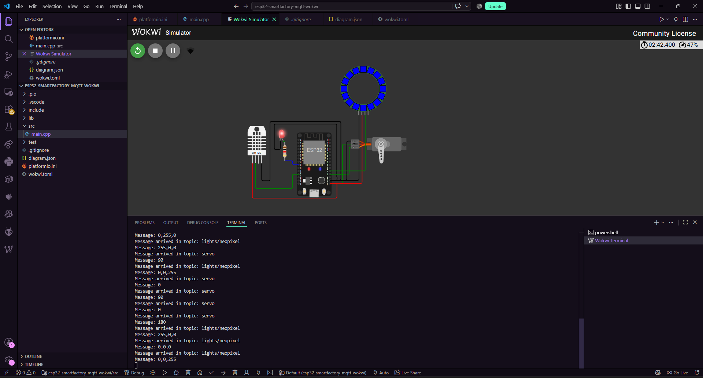
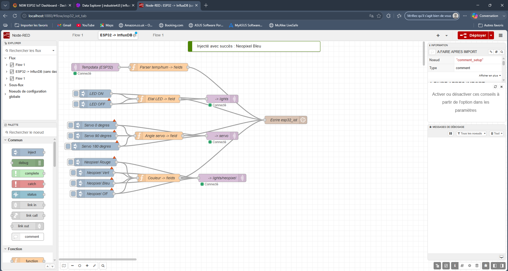
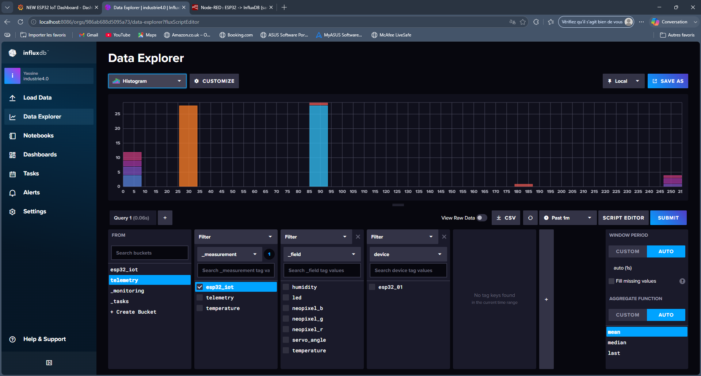
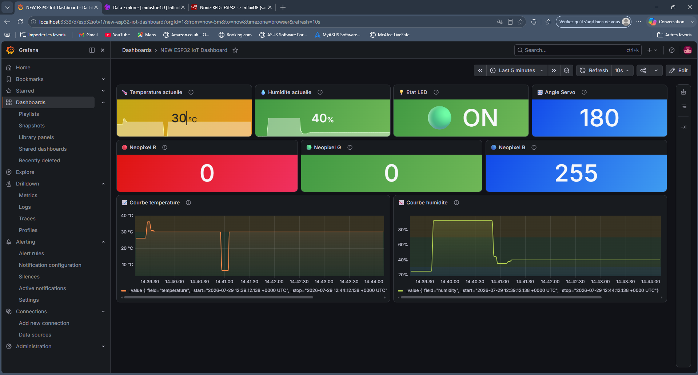

# ESP32 IoT Supervision — DHT22, LED, Servo, Neopixel

Chaîne IoT complète : un ESP32 simulé (Wokwi) publie ses mesures et l'état de ses
actionneurs en MQTT, Node-RED relaie les données vers InfluxDB, et Grafana s'occupe
de toute la visualisation.

## Origine du projet

La partie embarquée (ESP32 + DHT22 + LED + Servo + Neopixel, MQTT via un broker
public) reprend le tutoriel de [High Voltages](https://highvoltages.co) :

- Vidéo : https://www.youtube.com/watch?v=TNHAZxwB-9o
- Article : https://highvoltages.co/iot-internet-of-things/mqtt/mqtt-in-nodered-and-mqtt-dashboard/
- Simulation Wokwi d'origine : https://wokwi.com/projects/349943659510104658

L'auteur propose deux vidéos séparées, une côté embarqué et une côté supervision.
J'ai repris la première telle quelle et entièrement refait la seconde.

## Ce que j'ai gardé

- Le firmware ESP32 (DHT22, LED, servo, bandeau Neopixel, connexion MQTT)
- Le broker MQTT public (`broker.hivemq.com`), pratique pour un projet de démo sans
  infra à gérer

## Ce que j'ai refait

Le tutoriel original visualise et pilote tout depuis un dashboard `node-red-dashboard`
(jauges, switch, slider, color picker). Ce n'est pas un outil de supervision, plutôt
une UI de démo rapide, je l'ai remplacé par une vraie chaîne d'observabilité :

- **Node-RED** ne fait plus que relayer les données : parsing des messages MQTT et
  écriture dans InfluxDB. Les widgets `node-red-dashboard` ont été retirés et
  remplacés par de simples nœuds `inject` natifs pour déclencher les commandes de
  démonstration (LED, servo, couleur du Neopixel), sans dépendance supplémentaire.
- **InfluxDB** stocke l'historique de tous les champs (température, humidité, état
  LED, angle servo, couleur RVB) dans une mesure dédiée.
- **Grafana** affiche l'état courant (température, humidité, LED, servo, couleur) et
  l'historique temps/humidité sous forme de courbes.

## Architecture

```
ESP32 (Wokwi)
   |
   |  MQTT (broker public)
   v
Node-RED  --- parsing des topics, aucun affichage ---
   |
   |  écriture
   v
InfluxDB
   |
   |  requêtes Flux
   v
Grafana (supervision)
```

## Stack technique

| Composant       | Rôle                                      |
|------------------|--------------------------------------------|
| ESP32 (Wokwi)    | Simulation du matériel (DHT22, LED, servo, Neopixel) |
| PlatformIO + VS Code | Développement et compilation du firmware, via l'extension Wokwi (le simulateur en ligne wokwi.com était trop lent à compiler et poussait vers un plan payant) |
| MQTT (HiveMQ public) | Transport des mesures et des commandes |
| Node-RED         | Relais MQTT → InfluxDB (sans dashboard)   |
| InfluxDB         | Stockage des séries temporelles           |
| Grafana          | Supervision et visualisation              |

## Reproduire le projet

1. **Firmware** : ouvrir `Embedded/` dans VS Code avec l'extension Wokwi + PlatformIO,
   lancer la simulation.
2. **Node-RED** : importer `NodeRed/Nodered flow esp32 influxdb.json`, relier le nœud InfluxDB Out à votre
   propre configuration (URL, org, token, bucket).
3. **Grafana** : importer `Grafana/Grafana esp32 iot dashboar.json`, vérifier que la datasource
   InfluxDB pointe vers le bon bucket.

## Captures d'écran









## Crédits

Partie embarquée basée sur le tutoriel de High Voltages (voir liens ci-dessus).  
Partie supervision (Node-RED, InfluxDB, Grafana) conçue et développée
par moi-même.

## Auteur

**Yassine El Yazami** — Étudiant en Automatisation (EPHEC TECH)